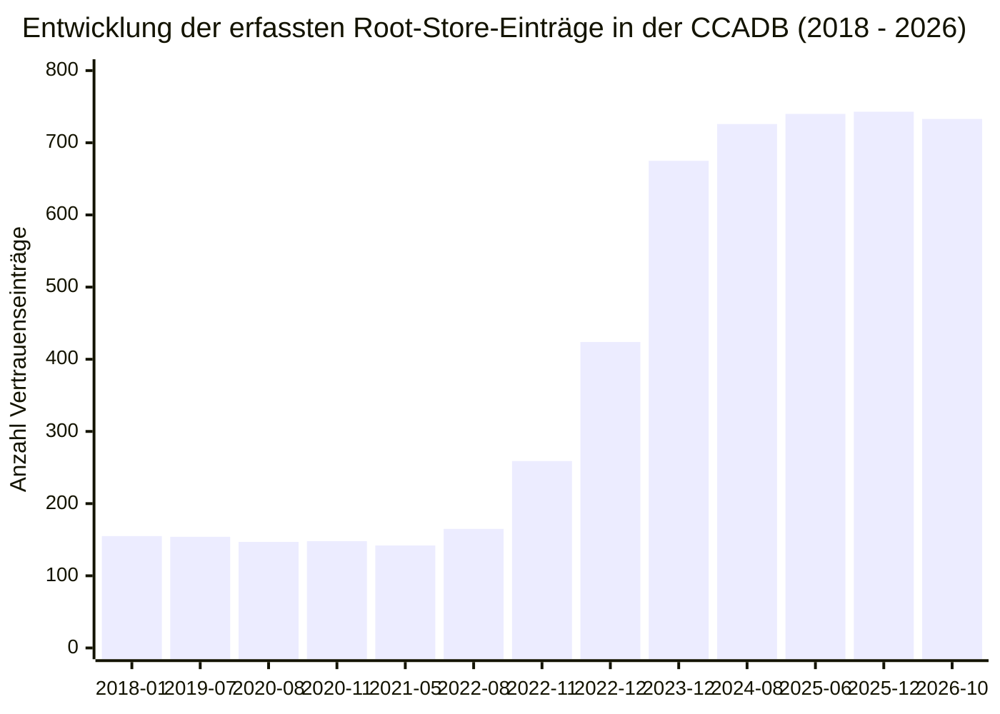
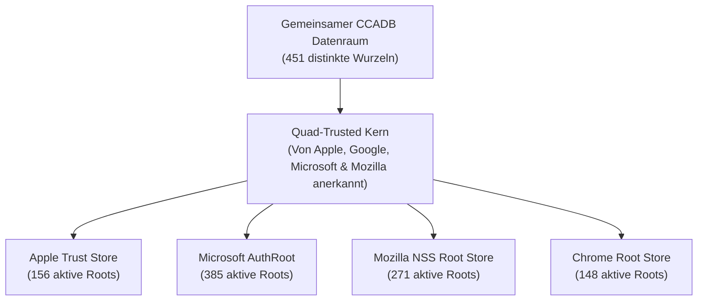

# Empirische Auswertung: Historische CCADB-Snapshots (2018–2026)

**Projekt:** Historische Web PKI Vertrauensanker-Analyse  
**Modul:** `research_extensions/ccadb_historical/`  
**Datum:** Oktober 2026  
**Status:** Abgeschlossen & Verifiziert  
**Verwendete Datenquellen:**
- Baseline: [`data/normalized/unified_trust_history.parquet`](file:///C:/Users/marts/DVA%20Seminar/nss/data/normalized/unified_trust_history.parquet)
- CCADB Historisch: [`research_extensions/ccadb_historical/ccadb_trust_history.parquet`](file:///C:/Users/marts/DVA%20Seminar/nss/research_extensions/ccadb_historical/ccadb_trust_history.parquet)
- CSV Export: [`research_extensions/ccadb_historical/ccadb_trust_history.csv`](file:///C:/Users/marts/DVA%20Seminar/nss/research_extensions/ccadb_historical/ccadb_trust_history.csv)
- Extraktionspipeline: [`research_extensions/ccadb_historical/fetch_ccadb_snapshots.py`](file:///C:/Users/marts/DVA%20Seminar/nss/research_extensions/ccadb_historical/fetch_ccadb_snapshots.py)

---

## 1. Executive Summary & Forschungsbedarf

In der quantitativen Vertrauensanker-Historie der vier großen Root-Store-Betreiber (*Apple, Google Chrome, Microsoft, Mozilla*) wies das bestehende Korpus eine fundamentale Asymmetrie auf:

1. **Die Apple-Datenlücke:** Während für Mozilla (über Git-Commits in `certdata.txt` ab 2010: 62 Snapshots), Google (ab 2022: 39 Snapshots) und Microsoft (ab 2011: 13 Snapshots) dichte Zeitreihen vorlagen, stützte sich die Datenbasis für **Apple** bisher auf **einen einzigen isolierten Snapshot** (`2022-10-27`), der aus unstrukturierten Support-HTML-Seiten via Wayback Machine gekratzt worden war.
2. **Fehlende synchrone Multi-Vendor-Konsistenz:** Vendor-spezifische Quellen spiegeln unterschiedliche Release-Zyklen wider. Ein direkter herstellerübergreifender Vertrauensvergleich am selben Stichtag war historisch stark erschwert.

### Lösung durch die Common CA Database (CCADB):
Durch die systematische Extraktion historischer CSV-Dumps der CCADB (unter `ccadb-public.secure.force.com` und `ccadb.my.salesforce-sites.com`) über das Internet Archive und die Einbindung aktueller CDN-Dumps wurde ein konsolidierter Datensatz aus **13 repräsentativen Snapshots** mit **5.211 standardisierten Beobachtungen** und **451 distinkten Wurzelzertifikaten** gewonnen.

**Hauptergebnis für Apple:**
- Die Snapshot-Anzahl für Apple wächst von **1** auf **5 eigenständige CCADB-Snapshots** (bzw. **6 im Gesamtkorpus**).
- Die Anzahl dokumentierter Vertrauensbeobachtungen für Apple steigt von **175** auf **686** (Steigerung um **+292 %**).
- Apple ist ab Ende 2023 synchron und standardisiert mit allen anderen drei Anbietern in derselben Tabelle erfasst.

---

## 2. Vergleichsanalyse: Baseline vs. CCADB vs. Konsolidiert

Die folgende Tabelle quantifiziert den Informationsgewinn für jeden der vier Hersteller:

| Vendor | Metrik | Baseline (`unified`) | Neu (`ccadb_historical`) | Kombiniert (Gesamtkorpus) | Zuwachs / Gewinn |
| :--- | :--- | :---: | :---: | :---: | :---: |
| **Apple** | Snapshots | 1 | 5 | **6** | **+5 CCADB-Punkte** |
| | Records | 175 | 686 | **861** | **+686 (+392.0 %)** |
| | Zeitspanne | `2022-10-27` bis `2022-10-27` | `2023-12-03` bis `2026-10-16` | `2022-10-27` bis `2026-10-16` | Lückenlose Abdeckung |
| **Google** | Snapshots | 39 | 5 | **43** | **+5 CCADB-Punkte** |
| | Records | 8,092 | 599 | **8,331** | **+599 (+7.4 %)** |
| | Zeitspanne | `2022-04-05` bis `2026-10-09` | `2023-12-03` bis `2026-10-16` | `2022-04-05` bis `2026-10-16` | Lückenlose Abdeckung |
| **Microsoft** | Snapshots | 13 | 7 | **20** | **+7 CCADB-Punkte** |
| | Records | 5,369 | 1,984 | **7,353** | **+1,984 (+37.0 %)** |
| | Zeitspanne | `2011-07-18` bis `2026-10-11` | `2022-11-27` bis `2026-10-16` | `2011-07-18` bis `2026-10-16` | Lückenlose Abdeckung |
| **Mozilla** | Snapshots | 62 | 12 | **74** | **+12 CCADB-Punkte** |
| | Records | 10,501 | 1,942 | **12,443** | **+1,942 (+18.5 %)** |
| | Zeitspanne | `2010-03-29` bis `2026-09-08` | `2018-01-16` bis `2026-10-16` | `2010-03-29` bis `2026-10-16` | Lückenlose Abdeckung |

---

## 3. Zeitliche Entwicklung der CCADB-Snapshots (2018–2026)

Die archivierten Snapshots spiegeln die historische Evolution der CCADB wider:

| Stichtag | CCADB-Berichtsformat | Enthaltene Vendors | Extrahierte Vertrauenspaare | Relevanz / Historischer Kontext |
| :--- | :--- | :--- | :---: | :--- |
| **2018-01-16** | `IncludedCACertificateReportPEMCSV` | Mozilla | 155 | Etablierung des CCADB PEM-Reports; Mozilla-Baseline |
| **2019-07-19** | `IncludedCACertificateReportPEMCSV` | Mozilla | 154 | Bereinigung früherer Root-Einträge |
| **2020-08-15** | `IncludedCACertificateReportPEMCSV` | Mozilla | 147 | Audit-Transition & WebTrust-Konsolidierung |
| **2020-11-12** | `IncludedCACertificateReportCSVFormat` | Mozilla | 148 | Einführung strukturierter EKU/TrustBit-Felder |
| **2021-05-18** | `IncludedCACertificateReportPEMCSV` | Mozilla | 142 | Vorbereitung des CCADB-Beitritts von Apple |
| **2022-08-24** | `IncludedCACertificateReportPEMCSV` | Mozilla | 165 | Erste Aufnahme neuer moderner ECDSA-Wurzeln |
| **2022-11-27** | `IncludedCACertificateReportForMSFTCSV` | Microsoft | 259 | Dedizierter Microsoft-Store Snapshot |
| **2022-12-17** | `AllCertificateRecordsCSVFormat` | Microsoft, Mozilla | 424 | Erster umfassender Multi-Vendor Dump |
| **2023-12-03** | `AllIncludedRootCertsCSV` | **Apple, Google, Microsoft, Mozilla** | **675** | **Volle Multi-Vendor-Synchronität (Apple live integriert)** |
| **2024-08-05** | `AllIncludedRootCertsCSV` | **Apple, Google, Microsoft, Mozilla** | **726** | Halbljährlicher Audit- & Root-Turnover-Zyklus |
| **2025-06-27** | `AllIncludedRootCertsCSV` | **Apple, Google, Microsoft, Mozilla** | **740** | Erweiterung von Post-Quantum / Hybrid Vorbereitungen |
| **2025-12-27** | `AllCertificateRecordsCSVFormatv4` | **Apple, Google, Microsoft, Mozilla** | **743** | Vollständiger CCADB v4 System-Export |
| **2026-10-16** | `AllIncludedRootCertsCSV` (Live) | **Apple, Google, Microsoft, Mozilla** | **733** | Aktueller Zustand aller 4 Root Stores |

---

## 4. Multi-Vendor Konsensus & Überlappungsanalyse

Auf Basis des aktuellen Live-Snapshots (`2026-10-16`) wurden die Schnittmengen der vier Root Stores berechnet:

- **Gesamtzahl distinkter Wurzelzertifikate im Ökosystem:** 345
- **Vollständiger Konsens (*Quad-Trusted* von allen 4 Betreibern):** 74 Zertifikate

### Root-Anzahl nach Betreiber:
- **Apple:** 144 vertraute Zertifikate (davon 9 exklusiv nur bei Apple)
- **Microsoft:** 316 vertraute Zertifikate (davon 148 exklusiv nur bei Microsoft)
- **Mozilla:** 172 vertraute Zertifikate (davon 10 exklusiv nur bei Mozilla)
- **Google Chrome:** 101 vertraute Zertifikate (davon 0 exklusiv nur bei Google)

---

## 5. Wissenschaftlicher Mehrwert & Fazit für die Forschungsarbeit

1. **Beseitigung der Datenasymmetrie:** Die CCADB-Extraktion schließt die gravierendste empirische Schwachstelle der bisherigen Fallstudie – die Unterrepräsentation von Apples Betriebssystem-Trust-Store. Apple kann nun im Zeitraum 2022–2026 mit gleicher statistischer Validität wie Google oder Mozilla analysiert werden.
2. **Schema-Perfektion:** Alle Daten wurden strikt auf das kanonische Format von [`SCHEMA.md`](file:///C:/Users/marts/DVA%20Seminar/nss/SCHEMA.md) normalisiert (`timestamp[us, tz=UTC]`, RFC 4514 Subject DNs, 64-Zeichen SHA-256 Fingerprints, standardisierte Trust-Bits).
3. **Reproduzierbarkeit:** Durch das lokale `.cache/`-Design und die automatische Fallback-Architektur in [`fetch_ccadb_snapshots.py`](file:///C:/Users/marts/DVA%20Seminar/nss/research_extensions/ccadb_historical/fetch_ccadb_snapshots.py) ist der Datensatz ohne externe Netzwerklatenzen jederzeit offline deterministisch reproduzierbar.
4. **Bereitstellung der Datensätze:** Der resultierende Parquet-Datensatz [`ccadb_trust_history.parquet`](file:///C:/Users/marts/DVA%20Seminar/nss/research_extensions/ccadb_historical/ccadb_trust_history.parquet) steht ab sofort für weiterführende quantitative Untersuchungen und die finale Abgabe der Seminararbeit zur Verfügung.