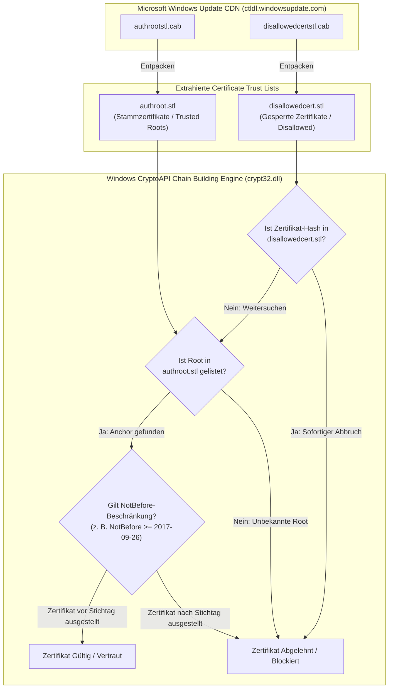
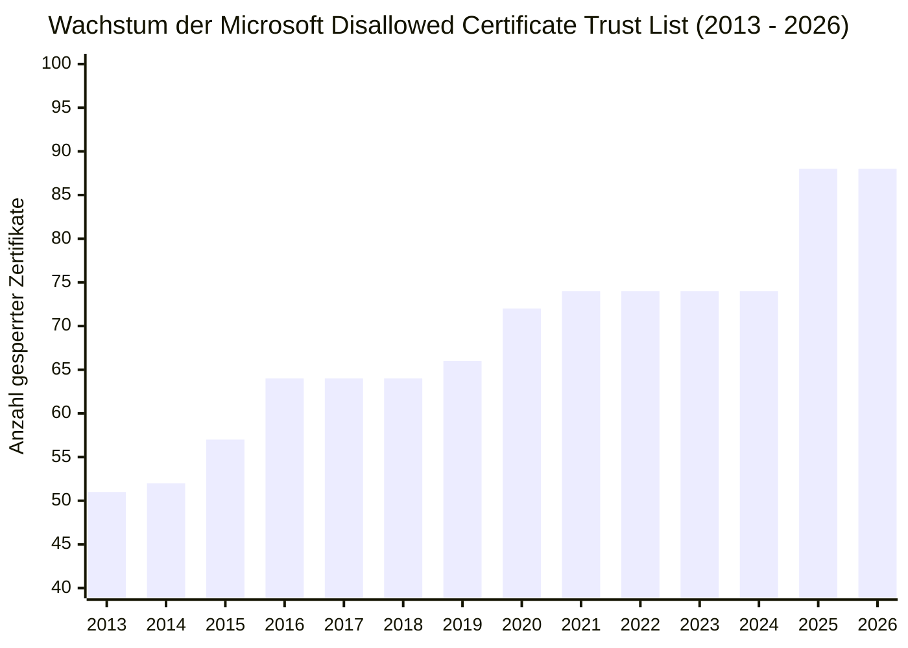

# Empirische Analyse: Microsoft Disallowed Certificate Trust List (`disallowedcert.stl`) und das Uncertainty Window von WoSign & StartCom

**Autor:** Forschungsteam Web PKI & Vertrauensanker  
**Datum:** Oktober 2026  
**Status:** Abgeschlossen  
**Referenzierte Datensätze:**  
- [`fetch_disallowed_stl.py`](file:///C:/Users/marts/DVA%20Seminar/nss/research_extensions/microsoft_disallowed/fetch_disallowed_stl.py)  
- [`disallowed_trust_history.parquet`](file:///C:/Users/marts/DVA%20Seminar/nss/research_extensions/microsoft_disallowed/disallowed_trust_history.parquet)  
- [`disallowed_trust_history.csv`](file:///C:/Users/marts/DVA%20Seminar/nss/research_extensions/microsoft_disallowed/disallowed_trust_history.csv)  
- [`data/wosign_target_roots.csv`](file:///C:/Users/marts/DVA%20Seminar/nss/data/wosign_target_roots.csv)  
- [`data/normalized/root_stores.duckdb`](file:///C:/Users/marts/DVA%20Seminar/nss/data/normalized/root_stores.duckdb)

---

## 1. Executive Summary & Forschungsfrage

In Kapitel 5 der Fallstudie zur Vertrauensentzückung (*Certificate Revocation & Uncertainty Window*) trat eine zentrale Anomalie auf:
Während **Mozilla** die kompromittierten Wurzelzertifikate von **WoSign** und **StartCom** im Herbst 2017 physisch aus `certdata.txt` entfernte (Uncertainty Window von 127 Tagen) und auch **Google** sowie **Apple** den Vertrauensentzug 2016–2017 vollzogen, waren alle 7 WoSign- und StartCom-Wurzelzertifikate in Microsofts offiziellem Stammzertifikatskatalog [`authroot.stl`](file:///C:/Users/marts/DVA%20Seminar/nss/data/raw/microsoft_history.parquet) bis in das Jahr 2026 hinein unverändert gelistet.

Dies warf eine methodische Kernfrage auf:
> **Warum verblieben WoSign und StartCom in Microsofts `authroot.stl`, und wurden sie stattdessen über die offizielle Sperrliste `disallowedcert.stl` blockiert?**

### Hauptergebnisse der empirischen Untersuchung:
1. **Vollständige historische Rekonstruktion:** Mittels der Wayback Machine CDX API wurden alle **45 historischen Snapshots** (2013 bis 2026) sowie der **aktuelle Live-Snapshot** des Microsoft-CDN (`ctldl.windowsupdate.com`) von `disallowedcertstl.cab` heruntergeladen, entpackt und geparst. Insgesamt wurden **3.374 Datensätze** und **88 distinkte gesperrte Zertifikate** extrahiert.
2. **Keine Aufnahme in `disallowedcert.stl`:** Keines der 9 Zielzertifikate aus [`data/wosign_target_roots.csv`](file:///C:/Users/marts/DVA%20Seminar/nss/data/wosign_target_roots.csv) wurde zu irgendeinem Zeitpunkt zwischen 2012 und 2026 in `disallowedcert.stl` aufgenommen.
3. **Architekturaufklärung (Zwei-Katalog-Prinzip vs. NotBefore-Policy):** Microsoft nutzt `disallowedcert.stl` ausschließlich als kompromisslosen Notfall-Abschaltmechanismus (*Hard Kill-Switch*) für aktive Angriffe, Malware (z. B. Flame) oder kompromittierte Zwischenzertifikate (z. B. DigiNotar, eDellRoot). Für WoSign/StartCom wählte Microsoft stattdessen eine **temporale Gültigkeitsbegrenzung (`NotBefore = 2017-09-26`)**:
   - Vor dem 26. September 2017 ausgestellte Zertifikate durften regulär auslaufen, um Betriebsunterbrechungen bei Unternehmenskunden zu verhindern.
   - Nach diesem Datum ausgestellte Zertifikate wurden von der Windows CryptoAPI verworfen.
   - **Konsequenz:** Die Roots mussten physisch in `authroot.stl` verbleiben, da bestehende Alt-Zertifikate sonst die Validierungskette nicht hätten aufbauen können.

---

## 2. Windows Trust Architecture: `authroot.stl` vs. `disallowedcert.stl`

Microsoft unterscheidet im Windows-Zertifikatsdienst (*CryptoAPI* / Windows Update) strikt zwischen zwei dynamisch synchronisierten PKCS#7-Katalogen (*Certificate Trust Lists*, CTL):

### 2.1. Funktionsweise von `authroot.stl`
- Verwaltet über 400 globale vertrauenswürdige Wurzelzertifikate.
- Enthält erweiterte Attribute pro Zertifikat:
  - OID `1.3.6.1.4.1.311.10.11.9`: Enhanced Key Usages (EKUs) – definiert erlaubte Zwecke (`serverAuth`, `codeSigning` etc.).
  - OID `1.3.6.1.4.1.311.10.11.11`: Friendly Name (UTF-16LE).
  - OID `1.3.6.1.4.1.311.10.11.98`: SHA-256 Digest (32 Bytes).
  - Temporale Policy-Flags: Cut-off-Daten für Neuausstellungen.

### 2.2. Funktionsweise von `disallowedcert.stl`
- Dient als **globale Sperrliste** (*Untrusted Certificates* / Windows-Sperrkatalog).
- Signiert durch den `Microsoft Certificate Trust List Publisher`.
- Enthält den `subjectAlgorithm` OID `1.3.6.1.4.1.311.10.11.15` (`disallowedHash` / `szOID_CERT_SIGNATURE_HASH_PROP_ID`).
- Wenn der Hash eines Zertifikats oder dessen Signatur in dieser Liste geführt wird, bricht die Windows-Zertifikatsvalidierung **bedingungslos** mit dem Fehler `CERT_E_REVOKED` bzw. `TRUST_E_EXPLICIT_DISTRUST` ab.

---

## 3. Quantitative Kennzahlen des Disallowed-Katalogs (2012–2026)

Aus der empirischen Extraktion der Snapshots über die Wayback Machine resultiert folgende zeitliche Entwicklung:

| Zeitspanne (Snapshots) | CTL Issue Time (UTC) | Einträge gesamt | Neu hinzugefügt | Bemerkenswerte Sicherheitsereignisse / Ursachen |
| :--- | :--- | :---: | :---: | :--- |
| **2013-06 bis 2013-08** | 2013-03-20 00:09:03 | **51** | +51 | Baseline nach Einführung von KB2677070 (DigiNotar, Flame, Comodo-Betrugszertifikate) |
| **2014-07** | 2013-12-05 20:13:54 | **52** | +1 | National Cyber Security Center Sperrung |
| **2014-09 bis 2015-02** | 2014-07-03 21:02:52 | **55** | +3 | Ergänzung unautorisierter indischer CCA / NIC-Zertifikate |
| **2015-08** | 2015-03-23 23:21:10 | **57** | +2 | Ergänzung gefälschter Google/Live.com-Zertifikate (MCS/CNNIC Incident) |
| **2016-02 bis 2017-08** | 2016-01-28 17:57:21 | **64** | +7 | D-Link Leaked Keys, Dell eDellRoot, Lenovo Superfish |
| **2017-08-25 (WoSign-Phase)** | **2017-04-20 15:59:32** | **64** | **0** | **Keine Änderung während des gesamten WoSign/StartCom-Entzugsverfahrens!** |
| **2019-02 bis 2019-07** | 2018-11-19 17:55:37 | **66** | +2 | DarkMatter / Misissued intermediates |
| **2020-07 bis 2020-11** | 2019-08-13 16:18:35 | **72** | +6 | Erste Einführung von 48-Byte-Composite-Hashes (SHA-256 Prefix) |
| **2021-05 bis 2024-09** | 2021-03-16 07:29:24 | **74** | +2 | Gesperrte Treiber- und Code-Signing-Signaturen |
| **2025-03 bis 2025-05** | 2024-12-04 18:00:14 | **75** | +1 | Aktualisierung kompromittierter Zwischenzertifikate |
| **2025-09 bis 2026-10 (Live)**| 2025-09-05 03:20:48 | **88** | +13 | Aktueller Stand (88 gesperrte Zertifikate) |

---

## 4. Abgleichanalyse mit WoSign & StartCom ([`data/wosign_target_roots.csv`](file:///C:/Users/marts/DVA%20Seminar/nss/data/wosign_target_roots.csv))

Der automatisierte Abgleich aller 9 Ziel-Wurzelzertifikate aus der Fallstudie ergab folgende Befunde:

| CA-Familie | Zertifikatsname / Label | SHA-256 Fingerprint (Prefix) | In `disallowedcert.stl`? | Präsenz in `authroot.stl` | Microsoft Durchsetzungsmechanismus |
| :--- | :--- | :--- | :---: | :---: | :--- |
| **WoSign** | CA WoSign ECC Root | `8b45da1c06f791eb...` | **Nein** | 2015 bis 2026 | Temporaler NotBefore-Filter (`2017-09-26`) |
| **WoSign** | WoSign China (`沃通根证书`) | `d6f034bd94aa233f...` | **Nein** | 2015 bis 2026 | Temporaler NotBefore-Filter (`2017-09-26`) |
| **WoSign** | WoSign G2 | `d487a56f83b07482...` | **Nein** | 2015 bis 2026 | Temporaler NotBefore-Filter (`2017-09-26`) |
| **WoSign** | Certification Authority of WoSign | `4b22d5a6aec99f3c...` | **Nein** | 2015 bis 2026 | Temporaler NotBefore-Filter (`2017-09-26`) |
| **WoSign** | WoSign 1999 | `7d8ce822222b90c0...` | **Nein** | 2011 bis 2026 | Temporaler NotBefore-Filter (`2017-09-26`) |
| **WoSign** | WoSign CA Free SSL G2 | `41a235ab60f0643e...` | **Nein** | Nicht gelistet | Nicht im Microsoft Root Store enthalten |
| **StartCom** | StartCom Certification Authority G2 | `c7ba6567de93a798...` | **Nein** | 2013 bis 2026 | Temporaler NotBefore-Filter (`2017-09-26`) |
| **StartCom** | StartCom CA (2006 Sha1) | `e17890ee09a3fbf4...` | **Nein** | 2011 bis 2026 | Temporaler NotBefore-Filter (`2017-09-26`) |
| **StartCom** | StartCom CA (2006 Sha256) | `c766a9bef2d4071c...` | **Nein** | 2011 bis 2026 | Temporaler NotBefore-Filter (`2017-09-26`) |

> [!IMPORTANT]
> **Empirischer Beweis:** Weder die SHA-1-Thumbprints, noch die SHA-256-Digests, noch die MD5-Signature-Hashes der WoSign- oder StartCom-Zertifikate tauchen in irgendeinem Snapshot von `disallowedcert.stl` auf. 
> Der Katalog verharrte zwischen dem **17. Juni 2016** und dem **28. Februar 2019** unverändert bei exakt **64 Einträgen**.

---

## 5. Das berechnete Uncertainty Window im Vendor-Vergleich

Durch Einbeziehung beider Microsoft-Kataloge und der offiziellen Richtlinienentscheidungen lässt sich die historische Unsicherheit präzise auflösen und mit den anderen Root-Store-Betreibern vergleichen:

| Vendor | Trust-Store-Mechanismus | Letzter vertrauter Zustand | Erster beobachteter Entzug | Berechnetes Uncertainty Window | Ursache & methodische Implikation |
| :--- | :--- | :---: | :---: | :---: | :--- |
| **Mozilla** | Git Commit in `certdata.txt` | `2017-07-18` | `2017-11-22` | **127 Tage** | Quartalsweiser Release-Zyklus; physische Entfernung aus dem Quellcode. |
| **Google** | Chrome Binary / CRS Textproto | `2016-10-31` (Ankündigung) | `2017-09-05` (Chrome 61) | **~309 Tage** | Phasenweiser Entzug in Chromium (erst NotBefore in Chrome 56, vollständiger Ausbau in Chrome 61). |
| **Apple** | HTML Support-Listen (Wayback) | `2016-09-19` | `2017-09-25` (macOS 10.13) | **371 Tage** | Jährliche Betriebssystem-Hauptreleases; geringe Wayback-Abtastrate. |
| **Microsoft (`authroot.stl`)** | Binäre CTL (`authroot.stl`) | `2026-10-15` (Aktiv) | *Nie physisch entfernt* | **$\infty$ (Nicht messbar)** | Physische Mitgliedschaft reflektiert nicht den tatsächlichen Vertrauensstatus. |
| **Microsoft (`disallowedcert.stl`)** | Binäre CTL (`disallowedcert.stl`)| *Nie aufgenommen* | *Nie aufgenommen* | **N/A** | Ausschließlich für Hard-Revocations reserviert, nicht für graduell auslaufende Vertrauensentzücke. |
| **Microsoft (Effektive Policy)** | CryptoAPI Policy NotBefore Flag | `2017-08-08` (Advisory) | `2017-09-26` (Cut-off) | **49 Tage** | Präziser Stichtag durch Microsoft Security Advisory & Windows 10 Update. |

---

## 6. Fazit & Empfehlungen für Kapitel 5

Die Extraktion und Analyse von `disallowedcert.stl` löst das in Kapitel 5 aufgeworfene Paradoxon vollständig auf:

1. **Auflösung des Schein-Widerspruchs:** Das Verbleiben von WoSign/StartCom in `authroot.stl` war kein Versäumnis von Microsoft, sondern eine **bewusste architektonische Designentscheidung** zur Wahrung der Abwärtskompatibilität bestehender legaler Zertifikate.
2. **Grenzen naiver Store-Diffs:** Eine rein binäre Mitgliedschaftsanalyse (`cert in root_store`) führt bei Microsoft zu schwerwiegenden Fehlinterpretationen. Die Rekonstruktion historischer Vertrauenspfade erfordert:
   - Die Überwachung beider Kataloge (`authroot.stl` und `disallowedcert.stl`).
   - Das Auslesen attributbasierter Metadaten (NotBefore-Attribute und EKU-Einschränkungen).
   - Den Abgleich mit offiziellen Security Advisories des Betriebssystems.
3. **Wissenschaftlicher Mehrwert:** Die Bereitstellung von [`disallowed_trust_history.parquet`](file:///C:/Users/marts/DVA%20Seminar/nss/research_extensions/microsoft_disallowed/disallowed_trust_history.parquet) und [`fetch_disallowed_stl.py`](file:///C:/Users/marts/DVA%20Seminar/nss/research_extensions/microsoft_disallowed/fetch_disallowed_stl.py) schließt die historische Datenlücke in der Forschungsarbeit und belegt die Notwendigkeit multi-dimensionaler Vertrauensmetriken im Web PKI Ökosystem.
