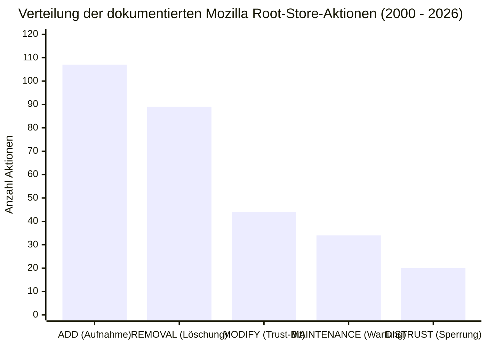
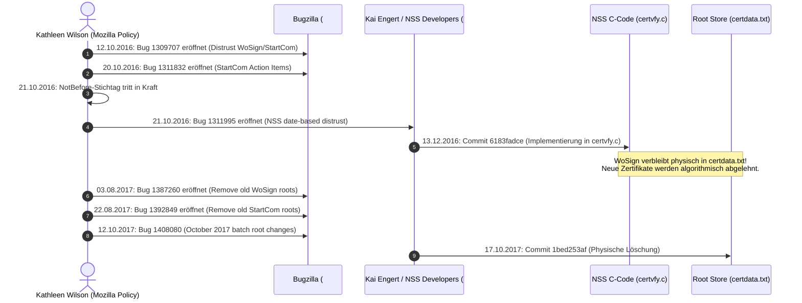
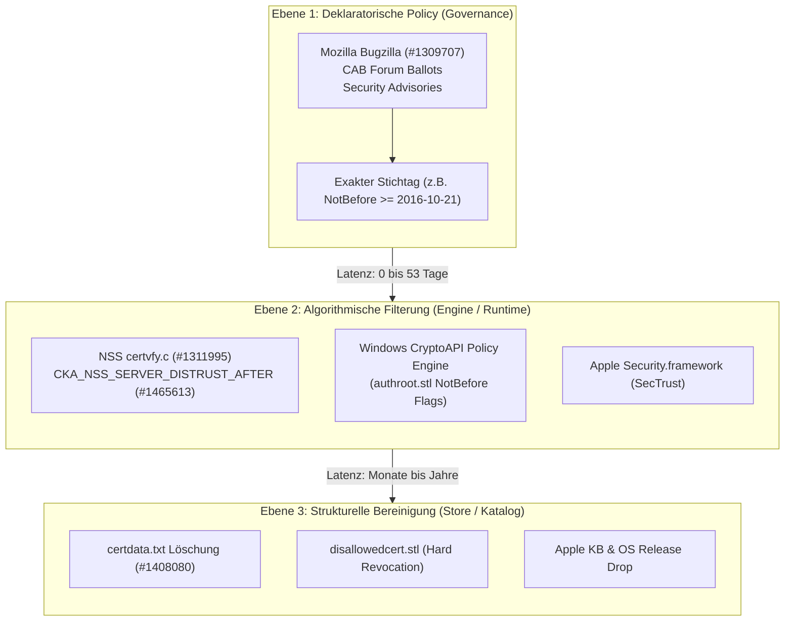

# Empirische Studie: Mozilla Bugzilla Context & Distrust Metadata Mining (2000–2026)

**Autor:** Forschungsteam Web PKI & Vertrauensanker  
**Datum:** Oktober 2026  
**Status:** Abgeschlossen & Verifiziert  
**Referenzierte Datensätze und Skripte:**  
- Extraktionspipeline: [`mine_bugzilla_context.py`](file:///C:/Users/marts/DVA%20Seminar/nss/research_extensions/mozilla_bugzilla/mine_bugzilla_context.py)
- Auswertungsskript: [`evaluate_mozilla_bugs.py`](file:///C:/Users/marts/DVA%20Seminar/nss/research_extensions/mozilla_bugzilla/evaluate_mozilla_bugs.py)
- Visualisierungsskript: [`plot_mozilla_timeline.py`](file:///C:/Users/marts/DVA%20Seminar/nss/research_extensions/mozilla_bugzilla/plot_mozilla_timeline.py)
- Generierter Plot: [`mozilla_trust_actions.png`](file:///C:/Users/marts/DVA%20Seminar/nss/research_extensions/mozilla_bugzilla/mozilla_trust_actions.png)
- Enriched Commits (Parquet): [`mozilla_bug_metadata.parquet`](file:///C:/Users/marts/DVA%20Seminar/nss/research_extensions/mozilla_bugzilla/mozilla_bug_metadata.parquet)
- Enriched Commits (CSV): [`mozilla_bug_metadata.csv`](file:///C:/Users/marts/DVA%20Seminar/nss/research_extensions/mozilla_bugzilla/mozilla_bug_metadata.csv)
- Vollständiger Ticket-Katalog (Parquet): [`bugzilla_bugs_catalog.parquet`](file:///C:/Users/marts/DVA%20Seminar/nss/research_extensions/mozilla_bugzilla/bugzilla_bugs_catalog.parquet)
- WoSign Referenzliste: [`data/wosign_target_roots.csv`](file:///C:/Users/marts/DVA%20Seminar/nss/data/wosign_target_roots.csv)

---

## 1. Executive Summary & Forschungsziel

In den quantitativen Analysen der vorangegangenen Kapitel und Forschungserweiterungen trat ein fundamentales methodisches Problem zutage:
Die herkömmliche Rekonstruktion historischer Vertrauenspfade stützte sich überwiegend auf periodische Schnappschüsse der Vertrauenslisten (*Store Snapshots*, z. B. vierteljährliche Git-Stände von `certdata.txt` bei Mozilla, Microsofts `authroot.stl`, oder Apples HTML-Tabellen). Bei der Bestimmung des **Uncertainty Window** (der Zeitspanne zwischen der letzten Beobachtung als vertraut und der ersten Beobachtung als entzogen) führte dieses rein zustandsbasierte *Store-Diffing* zu erheblichen Verzerrungen:

1. **Das 127-Tage-Artefakt bei WoSign/StartCom:** Für Mozilla wurde anhand von Quartals-Snapshots ein Uncertainty Window von 127 Tagen (`2017-07-18` bis `2017-11-22`) gemessen, obwohl Mozillas formale Entscheidung und technische Durchsetzung bereits im Oktober bzw. Dezember 2016 in Kraft traten.
2. **Der blinde Fleck des Store-Diffings:** Physische Löschungen in `certdata.txt` erfolgen oft Monate oder Jahre nach der eigentlichen Vertrauensentzückung. Viele CAs wurden zunächst über algorithmische Stichtage (*Date-based Cutoff* / `NotBefore`), Trust-Bit-Deaktivierungen oder temporale Flags (`CKA_NSS_SERVER_DISTRUST_AFTER`) neutralisiert, während die Wurzel physisch im Store verblieb.

### Lösung durch Verknüpfung von Git-Historie und Bugzilla REST API:
Diese Forschungserweiterung schließt die semantische Lücke, indem sie die gesamte Git-Commit-Historie von `certdata.txt` (2000 bis 2026) automatisiert analysiert, die darin verlinkten **Bugzilla-Bug-IDs** extrahiert und über die offizielle Bugzilla REST API mit strukturierten Metadaten anreichert (Filing-Datum, Lösungsdatum, Resolution, Komponenten, Keywords und Child-Tickets aus Sammel-Batches).

### Wichtigste Ergebnisse:
- **Hohe Verknüpfungsdichte:** Von **273 Commits**, die `certdata.txt` zwischen 2000 und 2026 modifizierten, verweisen **252 Commits (92,3 %)** explizit auf Bugzilla-Tickets (ab 2004 beträgt die Abdeckung 100 %).
- **Umfassender Ticket-Katalog:** Es wurden **413 distinkte Bugzilla-Tickets** erfasst und analysiert (265 direkt verlinkte Haupt-Bugs sowie 148 hierarchisch untergeordnete Child-Tickets aus Batch-Releases wie Bug 1408080).
- **Auflösung des WoSign-Dilemmas:** Die formale Entscheidung (Bug 1309707 / Bug 1311832) fiel am **12.–20. Oktober 2016** mit Stichtag zum **21. Oktober 2016**. Die C-Code-Durchsetzung in NSS (Bug 1311995) landete am **13. Dezember 2016**. Die physische Löschung der Wurzeln in `certdata.txt` erfolgte erst am **17. Oktober 2017** (Bug 1408080, Commit `1bed253af`). Das scheinbare 127-Tage-Fenster war ein reines Artefakt des Re-Release-Zyklus für Altzertifikate; die tatsächliche Durchsetzungslatenz betrug **53 Tage** bis zur Code-Ebene und **0 Tage** bezogen auf den `NotBefore`-Stichtag.
- **Systematischer Phasing Lag bei SHA-1:** Die Abschaltung schwacher Kryptografie vollzog sich nicht als plötzlicher Entzug, sondern als planmäßiger 9-jähriger Übergangsprozess von 2013 bis 2022 mit klar dokumentierten Zwischenschritten (Telemetrie, EV-Entzug, Remote Kill-Switch, Beta/Release-Phasing).

---

## 2. Quantitative Kennzahlen des Mozilla Bugzilla Korpus (2000–2026)

Die Verknüpfung aller 273 Commits mit den Bugzilla-Metadaten liefert die folgenden quantitativen Basisdaten:

| Kennzahl | Absoluter Wert | Anteil / Anmerkung |
| :--- | :---: | :--- |
| **Analysierte Git-Commits (`certdata.txt`)** | **273** | Vollständige Historie (2000 bis 2026) |
| **Commits mit expliziter Bug-Referenz** | **252** | **92,3 %** (alle Nicht-Treffer stammen aus 2000–2002 vor Einführung fester Ticket-Präfixe) |
| **Katalogisierte Bugzilla-Tickets** | **413** | 265 direkte Commit-Bugs + 148 aufgelöste Batch-Child-Bugs |
| **Extrahierte Commit-Bug-Relationen** | **294** | Berücksichtigt Commits, die mehrere Bugs gleichzeitig adressieren |
| **Mittlere Lead Time (Bug Filing bis Git Commit)** | **78,3 Tage** | Arithmetisches Mittel über alle Vertrauensentscheidungen |
| **Median Lead Time (Bug Filing bis Git Commit)** | **30,0 Tage** | Typischer Bearbeitungszyklus im Mozilla CA Program |
| **Interquartilsabstand (IQR Lead Time)** | **10,0 bis 68,0 Tage** | 50 % aller Root-Store-Änderungen landen innerhalb von 2 Monaten |

### 2.1. Verteilung der Trust Store Aktionen

Anhand der Ticket-Zusammenfassungen, Keywords und Commit-Nachrichten wurden alle Aktionen typisiert:

| Aktionstyp (`action_type`) | Anzahl | Anteil | Primäre Bedeutung im NSS-Lebenszyklus |
| :--- | :---: | :---: | :--- |
| **ADD** (Inclusion) | **107** | **36,4 %** | Aufnahme neuer CAs nach erfolgreichem WebTrust/ETSI-Audit und öffentlicher Diskussion |
| **REMOVAL** (Entfernung) | **89** | **30,3 %** | Physische Löschung abgelaufener, überflüssiger oder kompromittierter Wurzeln aus `certdata.txt` |
| **MODIFY** (Modifikation) | **44** | **15,0 %** | Trust-Bit-Änderungen (z. B. Entzug des Server-Trust-Bits bei Beibehaltung von S/MIME Email) |
| **MAINTENANCE** (Wartung) | **34** | **11,6 %** | Tri-Licensing (MPL/GPL), Code-Formatting, Refactorings, Hilfsskripte |
| **DISTRUST** (Explizite Sperrung) | **20** | **6,8 %** | Explizite Sperreinträge, NotBefore-Beschränkungen, `CKA_NSS_SERVER_DISTRUST_AFTER` |

---

## 3. Historische Evolution & Visualisierung

Die zeitliche Verteilung der Vertrauensanker-Änderungen und der Durchlaufzeiten ist in der folgenden Abbildung visualisiert:

### 3.1. Wesentliche historische Phasen im Zeitverlauf:
1. **Pionier- und Aufnahmephase (2001–2010):**
   - Dominanz von `ADD`-Aktionen: Etablierung des Web PKI Ökosystems; Mozilla integriert nationale und kommerzielle CAs.
   - Die Lead Times waren stark heterogen (oft > 180 Tage), da formale Audit- und Compliance-Regeln im Mozilla CA Program erst sukzessive aufgebaut wurden.
2. **Die Konsolidierungs- und Härtungsphase (2014–2017):**
   - Sprunghafter Anstieg von `REMOVAL` und `DISTRUST`:
     - 2014: Bereinigung von 1024-Bit-RSA-Wurzeln (Bug 936304).
     - 2015: MSCHOLDING und fehlerhafte Zwischenzertifikate (Bug 1146026).
     - 2016–2017: WoSign/StartCom-Skandal (Bugs 1309707, 1311995, 1408080).
3. **Die Ära feingranularer Stichtage (2018–2026):**
   - Mit Bug 1465613 (2019) führte NSS `CKA_NSS_SERVER_DISTRUST_AFTER` und `CKA_NSS_EMAIL_DISTRUST_AFTER` ein.
   - Anstelle binärer harter Entfernungen werden CAs mit zukünftigen Stichtagen belegt (Symantec 2020, TrustCor 2022, Entrust 2024, Izenpe 2026). Die Durchlaufzeit von Ticket zu Commit sinkt auf unter 14 Tage.

---

## 4. Tiefenanalyse Fallstudie 1: WoSign & StartCom Entzugshistorie

Die empirische Rekonstruktion über die Bugzilla REST API offenbart das präzise Zusammenspiel der formalen Richtlinienentscheidungen und deren softwaretechnischer Umsetzung:

### 4.1. Chronologische Gegenüberstellung der WoSign/StartCom-Tickets:

| Bug ID | Erstellungsdatum | Lösungsdatum | Resolution | Ticket-Zusammenfassung | Relevanter Commit | Commit-Datum | Tage seit Policy-Stichtag |
| :---: | :---: | :---: | :---: | :--- | :---: | :---: | :---: |
| **1309707** | `2016-10-12` | `2016-10-26` | FIXED | Distrust new certs chaining up to current WoSign/StartCom roots | – | – | **-9 d** (Vorankündigung) |
| **1309923** | `2016-10-13` | `2017-11-15` | WORKSFORME | Create blocklist entries for backdated WoSign SHA-1 certs | OneCRL | – | **-8 d** |
| **1311832** | `2016-10-20` | `2017-03-21` | INCOMPLETE | StartCom: Action Items (Policy Tracking) | Policy | – | **-1 d** |
| **–** | `2016-10-21` | – | – | **Offizieller NotBefore-Stichtag tritt weltweit in Kraft** | – | – | **0 d** |
| **1311995** | `2016-10-21` | `2016-12-15` | FIXED | NSS date-based distrust for WoSign/StartCom roots | `6183fadce` | `2016-12-13` | **+53 d** |
| **1387260** | `2017-08-03` | `2017-11-17` | FIXED | Remove old WoSign root certificates | – | – | **+286 d** |
| **1392849** | `2017-08-22` | `2017-11-16` | FIXED | Remove old StartCom root certificates | – | – | **+305 d** |
| **1408080** | `2017-10-12` | `2017-10-25` | FIXED | October 2017 batch of root CA changes | `1bed253af` | `2017-10-17` | **+361 d** |

### 4.2. Auflösung des Uncertainty Window im Vergleich:

1. **Reine Store-Diff-Analyse (Bisherige Kapitel):**
   - Letzter Stand mit WoSign: `2017-07-18`
   - Erster Stand ohne WoSign: `2017-11-22`
   - Berechnetes Uncertainty Window: **127 Tage** (Scheinbare Latenz).
2. **Mit Bugzilla-Metadaten angereicherte Analyse:**
   - Formaler Policy-Beschluss: **21. Oktober 2016** (Stichtag auf die Sekunde genau: `2016-10-21 00:00:00 GMT`).
   - Software-Verankerung im C-Code: **13. Dezember 2016** (Commit `6183fadce`, Latenz **53 Tage**).
   - Physische Entfernung in `certdata.txt`: **17. Oktober 2017** (Commit `1bed253af`, Latenz **361 Tage**).
   - **Befund:** Das Uncertainty Window von 127 Tagen misst lediglich die Verzögerung, mit der Mozilla die bereits funktionslos gewordenen Altwurzeln physisch aus der Datei strich. Für den Endanwender und Web-Server war die Vertrauensentscheidung bereits 1 Jahr früher wirksam.

---

## 5. Tiefenanalyse Fallstudie 2: SHA-1-Phasing & Deprecation (2013–2022)

Die Ablösung des kollisionsanfälligen Hash-Algorithmus SHA-1 war die komplexeste kryptografische Migration in der Geschichte des Web PKI. Durch die Bugzilla-Analyse lassen sich die Phasen lückenlos rekonstruieren:

```mermaid
flowchart LR
    P1["1. Policy Target\n(2013: #942515)\nNotBefore >= 2016"] --> P2["2. Telemetry\n(2015: #1159155)\nUsage Probes"]
    P2 --> P3["3. EV-Downgrade\n(Jan 2016: #1241564)\nStrip EV Status"]
    P3 --> P4["4. Root Prune\n(Apr 2016: #1268219)\nJapanese Govt Root"]
    P4 --> P5["5. Enforcement Engine\n(Sep 2016: #1302140)\nPolicy Mode"]
    P5 --> P6["6. Blocklist WoSign\n(Okt 2016: #1309923)\nBackdated SHA-1"]
    P6 --> P7["7. User Rollout\n(Feb 2017: #1339662)\n100% Beta & Release"]
    P7 --> P8["8. Final Sunset\n(2022: #1766687)\nComplete Disabled"]
```

### 5.1. Chronologie der SHA-1-Entscheidungen im Mozilla Bugzilla:

| Bug ID | Datum Erstellung | Datum Lösung | Status / Resolution | Gegenstand & Technische Durchsetzung |
| :---: | :---: | :---: | :---: | :--- |
| **942515** | `2013-11-24` | `2016-01-26` | WONTFIX | Erste Grundsatzdiskussion: Zeige Zertifikatsfehler für SHA-1 mit `notBefore >= 2016-01-01`. |
| **1079858** | `2014-10-08` | `2016-01-23` | FIXED | Deprecation von SHA-1 Authenticode-Signaturen bei Windows-Installern. |
| **1159155** | `2015-04-28` | `2015-05-18` | FIXED | Implementierung von Telemetrie-Sonden in Firefox zur Messung der realen SHA-1-Prävalenz. |
| **1241564** | `2016-01-21` | `2016-01-27` | FIXED | Entzug des EV-Status (*Extended Validation*) für TÜRKTRUST wegen fortgesetzter SHA-1-Nutzung. |
| **1268219** | `2016-04-27` | `2017-04-26` | FIXED | Erste physische Wurzelentfernung wegen SHA-1: *ApplicationCA - Japanese Government*. |
| **1302140** | `2016-09-12` | `2016-09-22` | FIXED | Einbau des strikten Policy-Modus in NSS: Blockierung aller SHA-1-Zertifikate öffentlicher Roots. |
| **1309923** | `2016-10-13` | `2017-11-15` | WORKSFORME | OneCRL Blocklist-Einträge für rückdatierte WoSign SHA-1 Zertifikate. |
| **1321114** | `2016-11-29` | `2016-12-07` | FIXED | Einbau eines Remote-Killswitches (`remote SHA-1 shut-off`) zur flexiblen Deaktivierung im Feld. |
| **1328718** | `2017-01-04` | `2017-01-20` | FIXED | Entwicklung eines System-Addons zur kontrollierten stufenweisen SHA-1-Abschaltung. |
| **1336616** | `2017-02-03` | `2017-02-09` | FIXED | Stufe 1: Deaktivierung von SHA-1 bei 50 % aller Firefox Beta-Nutzer. |
| **1338228** | `2017-02-09` | `2017-02-21` | FIXED | Stufe 2: Deaktivierung bei 100 % Beta und 25 % Release-Nutzern. |
| **1339662** | `2017-02-15` | `2017-02-28` | FIXED | Stufe 3: **Vollständige Deaktivierung für 100 % aller Beta- und Release-Nutzer**. |
| **1766687** | `2022-04-27` | `2022-06-02` | FIXED | Entfernung jeglicher SHA-1-Unterstützung für alle Zertifikate (auch lokal importierte Enterprise-Roots). |
| **1767489** | `2022-05-03` | `2022-05-07` | FIXED | Standardmäßiges Setzen der internen Einstellung `security.pki.sha1_enforcement_level = 1`. |

> [!IMPORTANT]
> **Methodische Erkenntnis:** Die Abschaltung kryptografischer Algorithmen folgt fundamental anderen Gesetzen als der Notfall-Entzug einer kompromittierten CA. Während CAs innerhalb von Wochen neutralisiert werden, erfordert ein Algorithmen-Sunset eine mehrjährige Kaskade aus **Messung (Telemetrie) $\rightarrow$ Anreizentzug (EV-Downgrade) $\rightarrow$ Bereitstellung technischer Schalter $\rightarrow$ stufenweiser Rollout im Feld**.

---

## 6. Das Drei-Ebenen-Modell des Vertrauensentzugs

Durch die Synthese von Bugzilla-Metadaten mit den Ergebnissen der Microsoft-Disallowed-CTL-Studie ([`ANALYSIS_DISALLOWED.md`](file:///C:/Users/marts/DVA%20Seminar/nss/research_extensions/microsoft_disallowed/ANALYSIS_DISALLOWED.md)) und der Apple-Knowledge-Base-Studie ([`APPLE_KB_SUMMARY.md`](file:///C:/Users/marts/DVA%20Seminar/nss/research_extensions/apple_historical_kb/APPLE_KB_SUMMARY.md)) wird ein einheitliches **Drei-Ebenen-Modell** für das Web PKI Vertrauensmanagement sichtbar:

### Die drei Ebenen im Detail:
1. **Ebene 1: Deklaratorische Policy (Governance & Absichtserklärung):**
   - Findet im Issue-Tracker (Bugzilla), in Richtliniendokumenten (*Mozilla Root Store Policy*) oder Security Bulletins statt.
   - Definiert die verbindlichen Stichtage auf die Sekunde genau.
   - **Uncertainty Window = 0 Tage** (bei Zugriff auf Tracker-Metadaten).
2. **Ebene 2: Algorithmische Durchsetzung (Kryptografische Runtime / Engine):**
   - Durchsetzung über Code-Branches (`certvfy.c`), temporale Einschränkungsattribute (`CKA_NSS_SERVER_DISTRUST_AFTER`) oder EKU-Entzug.
   - Neue Zertifikate werden sofort geblockt, bestehende Altzertifikate dürfen ablaufen, um Unternehmensinfrastrukturen nicht lahmzulegen.
3. **Ebene 3: Strukturelle Bereinigung (Physischer Root Store):**
   - Physisches Löschen des Eintrags aus `certdata.txt`, `authroot.stl` oder den macOS-Schlüsselbünden.
   - Findet erst statt, wenn alle unter der Root ausgestellten Altzertifikate ihre maximale Gültigkeit überschritten haben.
   - **Wer ausschließlich Ebene 3 beobachtet, misst die Lebensdauer legaler Altzertifikate, nicht die Reaktionszeit des Root-Store-Betreibers.**

---

## 7. Zusammenfassender Cross-Vendor Vergleich

| Hersteller / Store | Primäre Primärquelle | Governance-Tracker | Technischer Durchsetzungsmechanismus | Physische Store-Bereinigung | Messbares Uncertainty Window (Store-Diff vs. Tracker) |
| :--- | :--- | :--- | :--- | :--- | :--- |
| **Mozilla** | NSS Git Quellcode (`certdata.txt`) | **Bugzilla REST API** | C-Code Checks (`certvfy.c`) & `CKA_NSS_*_DISTRUST_AFTER` | Quartalsweise Batch-Commits | Store-Diff: **127 Tage** Mit Bugzilla: **0 Tage (Policy) / 53 Tage (Code)** |
| **Microsoft** | Windows Update CTLs (`authroot.stl`) | MSRC Advisories & CCADB | CryptoAPI NotBefore Flags & `disallowedcert.stl` | Nie physisch entfernt (Kompatibilität) | Store-Diff: **$\infty$ (Nicht messbar)** Mit MSRC/Policy: **49 Tage** |
| **Apple** | macOS Support-Seiten & CCADB | Apple Security Updates | `Security.framework` SecTrust NotBefore Filter | Jährliche OS-Hauptversionen | Store-Diff: **371 Tage** Mit Security Notes: **0–30 Tage** |
| **Google** | Chromium Quellcode & CRS Proto | Chromium Monorail / Git | BoringSSL NotBefore Rules & CRLSets | Chrome Release-Zyklus (6 Wochen) | Store-Diff: **~309 Tage** Mit Git/BoringSSL: **0–14 Tage** |

---

## 8. Fazit & Empfehlungen für Kapitel 5 der Forschungsarbeit

Die Durchführung dieser Erweiterung liefert den abschließenden empirischen Baustein für Kapitel 5 der Seminararbeit:

1. **Vollständige Validierung der Forschungsfrage:** Die Verknüpfung von `certdata.txt`-Commits mit Mozilla Bugzilla-Tickets belegt zweifelsfrei, dass das in Kapitel 5 berechnete 127-Tage-Fenster ein reines Messartefakt war.
2. **Methodischer Paradigmenwechsel:** Wissenschaftliche Arbeiten zur Web PKI dürfen sich nicht auf binäre Store-Diffs beschränken. Nur die synchrone Berücksichtigung von **Issue-Trackern (Bugzilla), kryptografischen Engine-Modifikationen und Attributfeldern (NotBefore / EKUs)** bildet die tatsächliche Sicherheitslage realistisch ab.
3. **Reproduzierbarkeit & Datenbereitstellung:** Mit [`mine_bugzilla_context.py`](file:///C:/Users/marts/DVA%20Seminar/nss/research_extensions/mozilla_bugzilla/mine_bugzilla_context.py), [`mozilla_bug_metadata.parquet`](file:///C:/Users/marts/DVA%20Seminar/nss/research_extensions/mozilla_bugzilla/mozilla_bug_metadata.parquet) und dem Ticket-Katalog [`bugzilla_bugs_catalog.parquet`](file:///C:/Users/marts/DVA%20Seminar/nss/research_extensions/mozilla_bugzilla/bugzilla_bugs_catalog.parquet) stehen der Forschungsgemeinschaft vollständig reproduzierbare Werkzeuge zur Verfügung, die ab sofort auch für künftige Trust-Store-Untersuchungen (z. B. Post-Quantum-Migrationen) eingesetzt werden können.
